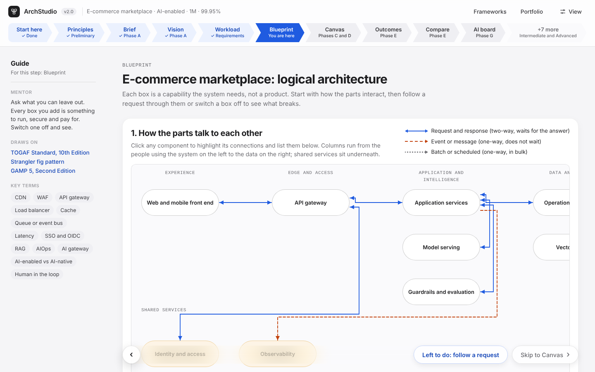

# ArchStudio: a practice studio for system and enterprise architecture

**By:** Divya Dubey **Role:** product owner and designer · **Timeline:** three days, more than 20 published iterations · **Status:** working prototype, not yet tested with learners

## The problem

Architects learn by designing systems at scale, and most people never get that chance before they are expected to lead one. Reference material is plentiful: books, cloud frameworks, engineering blogs, GitHub. What is missing is a safe place to make design decisions, see their consequences and defend them, the way a senior architect does in a real review.

## What I built

ArchStudio takes a learner from a plain-language brief to a design they can defend at a review board. The path follows the TOGAF Architecture Development Method:

- **Brief.** Describe the system in your own words. Claude maps the brief onto a catalogue of building blocks and asks clarifying questions.
- **Workload.** Size the system from first principles: load, read/write ratio, latency budget and consistency. The numbers decide which building blocks are needed, and the working is shown.
- **Blueprint and Canvas.** See how the parts interact, follow a request hop by hop, switch a part off to see what breaks, then assemble the design from building blocks.
- **Outcomes and Compare.** Build competing designs from real open source and commercial products, then compare them on scale, cost, operability, portability, availability and integration conflicts.
- **Drill and review.** Run failure scenarios tied to real incidents, then face a review board, with Claude playing the board members.

Two lenses change the path. **System first** suits solution architects. **Enterprise portfolio first** starts from business capabilities and the existing estate, and treats the solution as one change in the portfolio.

## Decisions that shaped it

1. **Reasons before products.** Every building block carries a plain explanation, an analogy and what breaks without it, so learners understand why it exists before choosing a product.
2. **Show the working.** Every score, availability figure and cost index can be expanded into its arithmetic. Learners should be able to challenge the tool.
3. **Neutral by default.** Products are not pre-selected and no vendor is preferred. Example "enterprise standards" libraries exist for practice, follow a written rule and are clearly labelled.
4. **AI as a design dimension.** Every design can be set to no AI, AI-enabled or AI-native, which changes the building blocks, failure drills, governance checks and review questions.

## What testing my own prototype taught me

- **Keyword matching could not read real briefs.** A request for an SAP ERP for a pharma company produced a generic web app. I moved interpretation to Claude, which reads any brief and states its assumptions and gaps.
- **Hidden assumptions crept in.** SAP tools appeared in a ServiceNow design, and an early standards library quietly favoured particular vendors. Both now follow the platform the user actually names.
- **Layouts did not teach.** Learners need to see what calls what, so a flowchart with typed arrows (request, event, batch) now comes before the layered view.

## Scope at a glance

| | |
|---|---|
| Reference models | 13, from e-commerce and streaming to SAP, HR, CRM, ITSM and multi-agent systems |
| Building blocks | 50, with 156 product options (64 open source, 92 commercial) |
| Design rules | 26 automatic checks for interoperability and non-functional gaps |
| Failure drills | 10, each linked to a public incident or published deadline |
| Learning aids | 51 glossary terms, 10 checkpoint quizzes, 3 skill levels |

## Limits and next steps

- Scores are curated judgements, not measurements. They are directional, and the tool says so.
- It has not been tested with learners. The next step is a short pilot with aspiring architects, measuring whether their designs and review answers improve.
- The catalogue is hand-maintained. A live feed of release, licence and security signals from GitHub and vendor sources would keep it current.

## How it was built

I set the direction, requirements and design judgement, and reviewed every iteration. Claude (Anthropic) was my build partner for code and content. The app is one self-contained HTML file with no backend; features that need Claude or saved portfolios work when it is opened inside Claude.
