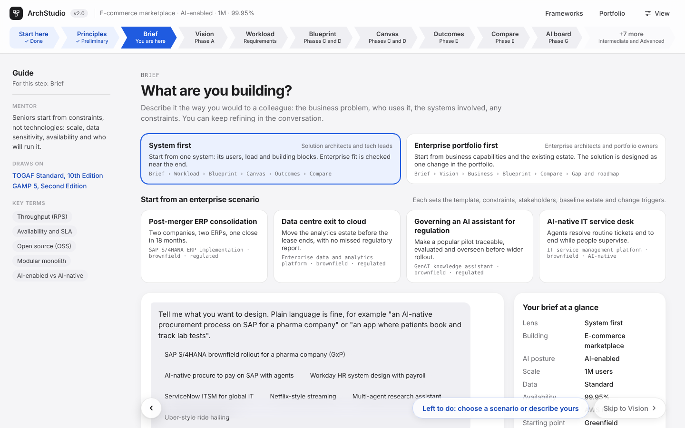
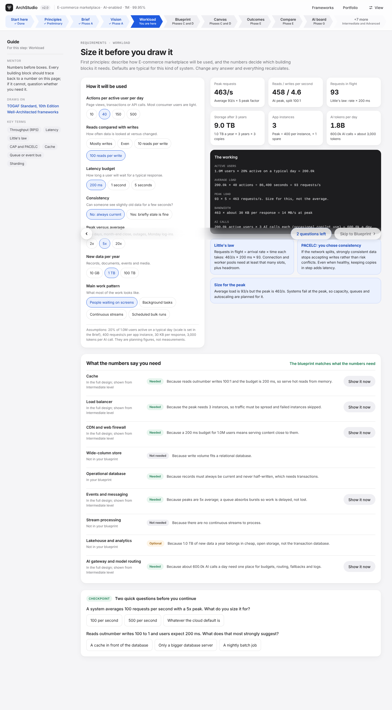
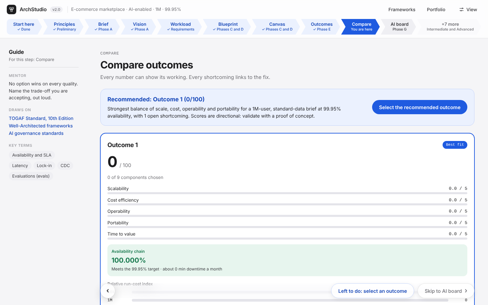
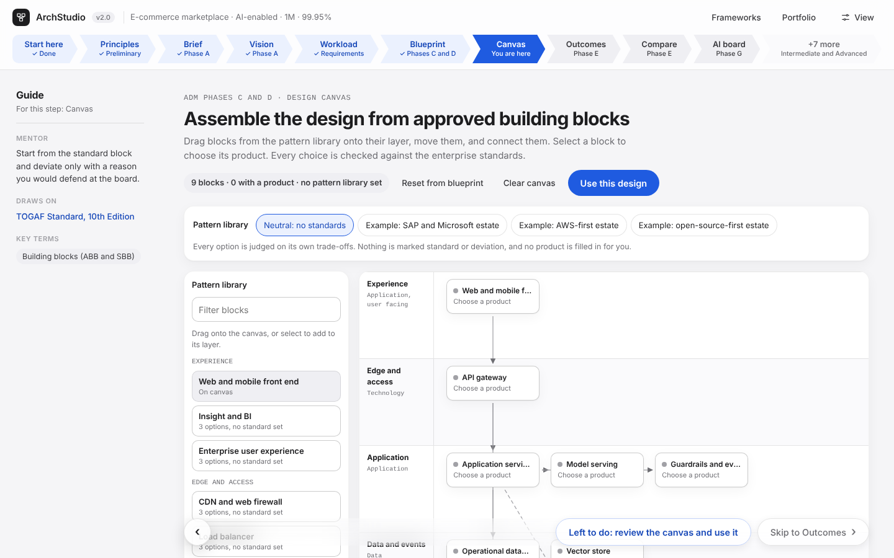
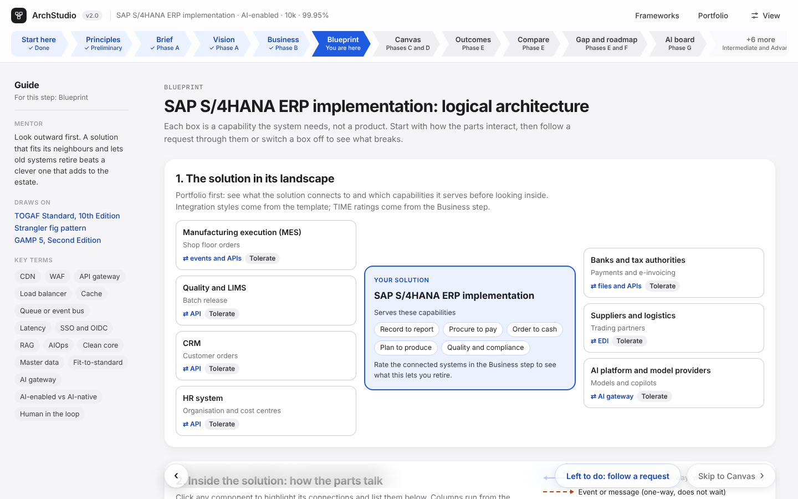

# ArchStudio

A practice studio for designing system and enterprise architectures, from a plain-language brief to a design you can defend at a review board.

**Read the [case study](CASE_STUDY.md)** for the problem, the decisions behind the design and what I learned building it.

## Try it

**[Open ArchStudio in your browser](https://dd-hands-on.github.io/archstudio/app/)**, or download [`app/index.html`](app/index.html) and open it. Nothing to install, no account needed.

| | In your browser | Inside Claude |
|---|---|---|
| Every design step, drill and check | Yes | Yes |
| Free-form briefs read by AI | Connect your own model (below); otherwise keyword matching | Claude |
| AI review board | With your own model | Claude |
| Saved portfolio | In this browser only | Shared, with team mode |

### Connect your own AI model (optional)

Open **View options → AI model** and choose Anthropic, OpenAI, Google Gemini or a local model through Ollama. ArchStudio calls the provider straight from your browser. It has no server, so your key never reaches this repository or anyone else. The key is forgotten when you close the tab unless you choose to remember it on your device. Use a key with a spending limit.

For Ollama, start it with `OLLAMA_ORIGINS` set to the site's address (for example `https://dd-hands-on.github.io`) so the browser is allowed to call it.

## Practice tracks

Choose how to practise on the first screen, or any time from **View**:

| Track | Time | Steps |
|---|---|---|
| System design interview | About 30 minutes | Brief › Workload › Blueprint › Drill |
| Trade-off practice | About 20 minutes | Brief › Canvas › Outcomes › Compare |
| Full journey | Several sessions | Every step below |

## What it covers

| Step | What you do |
|---|---|
| Principles and Vision | Agree architecture principles, stakeholders, drivers and scope |
| Brief | Describe the system or business change; choose system-first or portfolio-first |
| Workload | Size the system from first principles and see which building blocks the numbers require |
| Business | Rate capability maturity and classify the application portfolio (TIME) |
| Blueprint | See how the parts interact, follow a request, switch parts off |
| Canvas | Assemble the design from building blocks and choose products |
| Outcomes and Compare | Build competing designs and compare their trade-offs |
| Gap and roadmap | Plan transition architectures from baseline to target |
| Drill | Run failure scenarios tied to real incidents, and a STRIDE threat model |
| AI board and Review | Defend the design and sign the architecture contract |

## Screenshots

| | |
|---|---|
|  |  |
| Workload: first-principles sizing | Compare: trade-offs with visible working |
|  |  |
| Canvas: building blocks and products | Portfolio-first lens: the solution in its landscape |

## Frameworks it draws on

TOGAF Standard (10th Edition), ArchiMate, ISO/IEC/IEEE 42010, architecture decision records, the Gartner TIME model, the AWS, Azure and Google Cloud Well-Architected frameworks, the strangler fig pattern, STRIDE, the EU AI Act, NIST AI RMF and ISO/IEC 42001, GAMP 5 and the FinOps Framework. The Frameworks panel in the app links to each official source.

## Repository contents

- `app/index.html`: the complete app in one file
- `app/vendor/`: morphdom 2.7.4 (MIT licence), the one library the app uses
- `CASE_STUDY.md`: one-page case study
- `docs/build-log.md`: how the app evolved, version by version
- `docs/screenshots/`: screenshots of key steps

## Notes

Product scores are curated judgements to support learning, not benchmarks. Product names belong to their owners; no vendor endorses this project.
